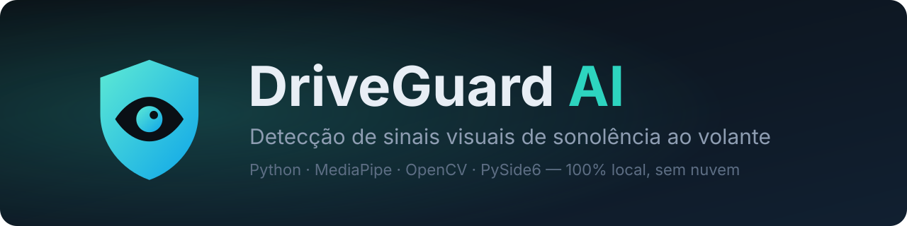
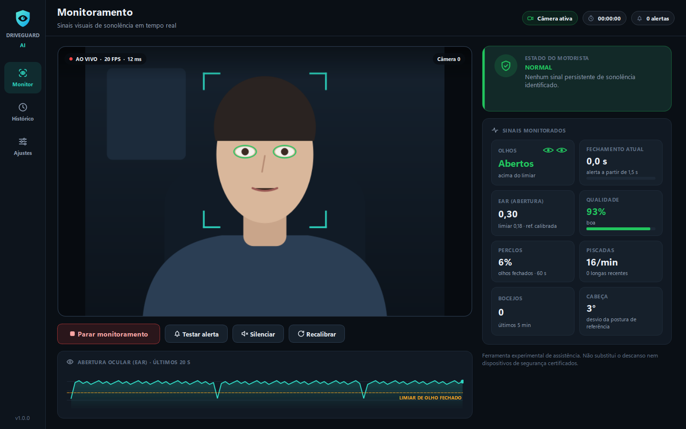
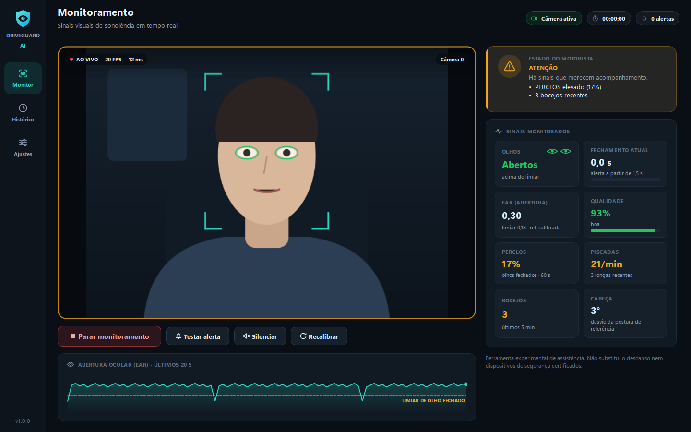
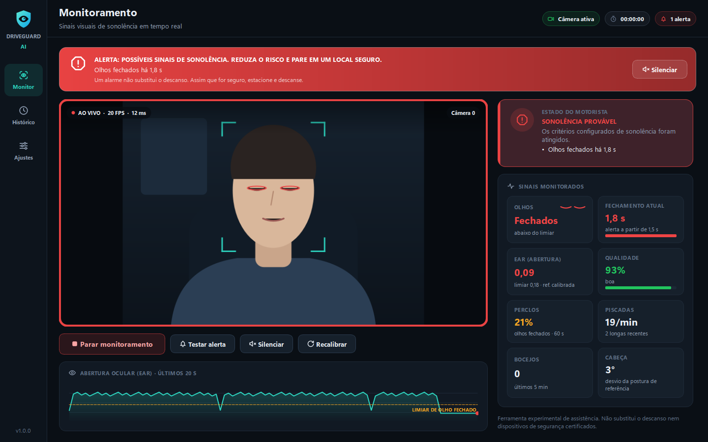
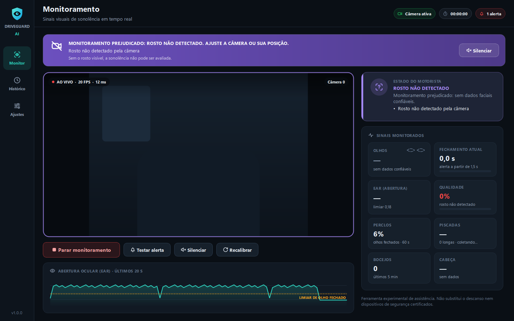
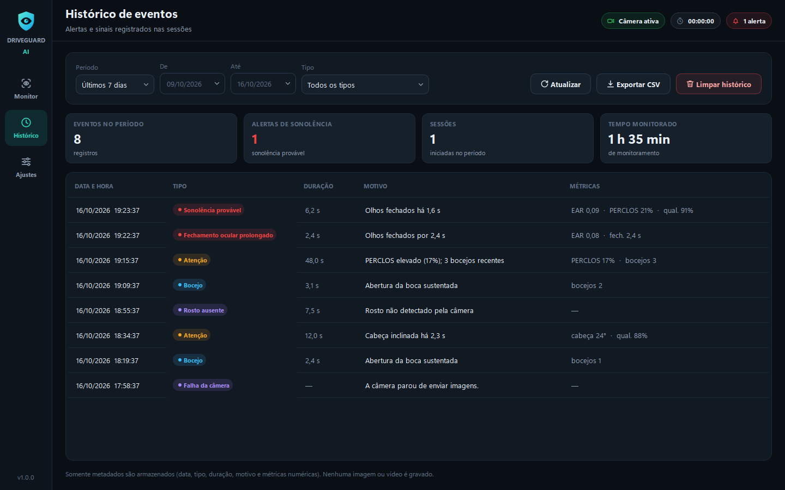
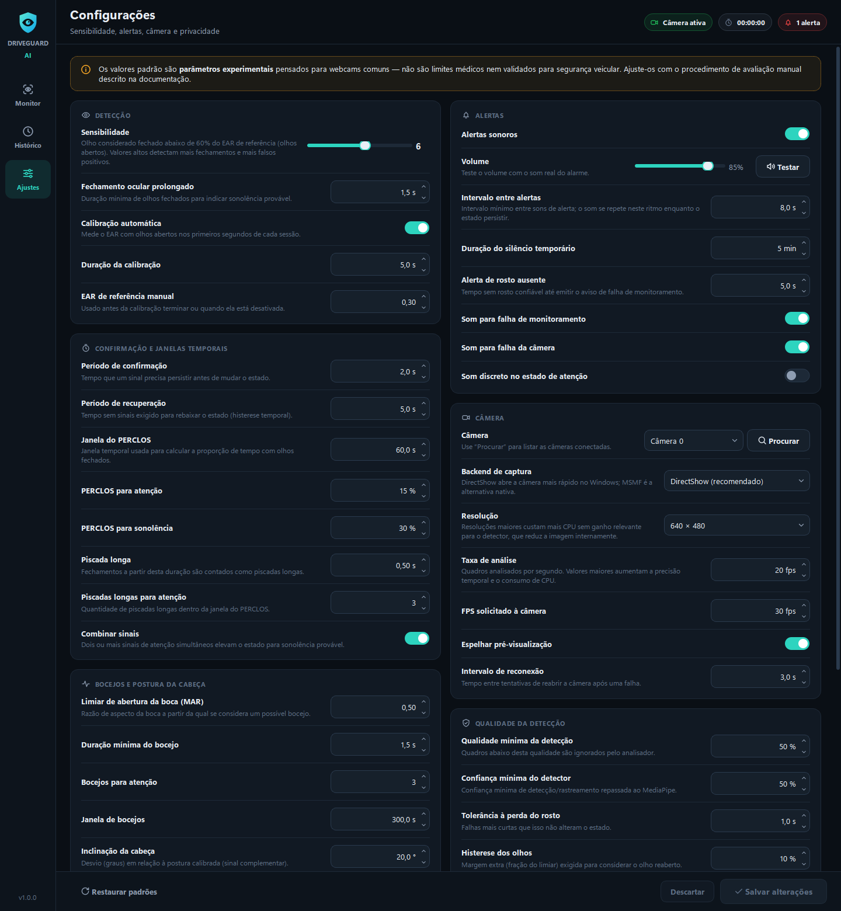
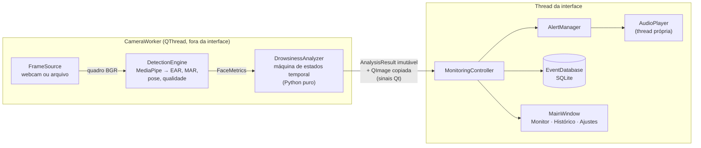

<div align="center">



<br>


-41CD52?logo=qt&logoColor=white)


**Sistema experimental que observa olhos, boca e postura da cabeça por uma webcam comum e alerta o motorista quando surgem sinais persistentes de sonolência.**

[Funcionalidades](#-funcionalidades) · [Telas](#-telas) · [Instalação](#-instalação-no-windows) · [Como funciona](#-como-a-detecção-funciona) · [Testes](#-testes) · [Limitações](#-limitações-técnicas)

</div>

> [!WARNING]
> O DriveGuard AI é uma **ferramenta experimental de assistência**, não um dispositivo de segurança automotiva certificado. Pode falhar (falsos negativos) e alarmar sem necessidade (falsos positivos). **Nenhum alarme substitui o descanso**: se sentir sono, pare em um local seguro. Não teste o sistema enquanto dirige.

---

## 🎯 Problema que resolve

Fadiga e sonolência aumentam o tempo de reação e podem causar *microcochilos*, fechamentos de olhos de um a alguns segundos, muitas vezes sem que o motorista perceba. Quem passa longos períodos ao volante (viagens, entregas, transporte) se beneficia de um aviso externo quando aparecem sinais visuais persistentes de cansaço.

O DriveGuard AI observa esses sinais pela câmera e chama a atenção do motorista, sempre incentivando a **parar e descansar**, sem sugerir que o alarme permita continuar dirigindo com sono.

## ✨ Funcionalidades

<table>
<tr>
<td width="50%" valign="top">

**👁️ Visão computacional**
- Captura de webcam em **thread separada**, com seleção de câmera, reconexão automática e tratamento de câmera ocupada ou desconectada
- Malha facial de **478 pontos** (MediaPipe Face Landmarker)
- Métricas por quadro: **EAR** (abertura dos olhos), **MAR** (boca), **pose da cabeça** e **qualidade da detecção**
- **Calibração automática** por usuário (olhos abertos e postura natural)

</td>
<td width="50%" valign="top">

**⏱️ Análise temporal**
- Nenhuma decisão com base em um único quadro
- Fechamento prolongado × piscadas normais
- **PERCLOS** em janela deslizante, piscadas longas, bocejos e inclinação da cabeça
- Histerese, confirmação, recuperação e combinação de sinais
- Tolerância a falhas curtas; reinício dos rastreadores ao perder o rosto

</td>
</tr>
<tr>
<td width="50%" valign="top">

**🔔 Alertas**
- Alarme **sintetizado por código** (sem arquivos de áudio) tocado em thread própria, sem travar a interface
- Banner pulsante com o **motivo provável** e a recomendação de parar em local seguro
- Intervalo mínimo entre sons, volume e **silêncio temporário** sem desligar o monitoramento
- Falhas de monitoramento (rosto ausente, câmera) têm **cor e som distintos** do alerta de sonolência

</td>
<td width="50%" valign="top">

**🖥️ Interface e dados**
- Aplicação desktop PySide6 com tema escuro automotivo
- Histórico em **SQLite** com filtros, resumo, exportação CSV e limpeza com confirmação
- Configurações persistentes com validação e restauração de padrões
- **Privacidade:** nenhuma imagem é gravada ou enviada à rede

</td>
</tr>
</table>

## 🖼️ Telas

> As capturas abaixo são da **interface real**, mas usam **dados de demonstração**: o vídeo é uma ilustração (nenhuma pessoa real) e as métricas e eventos são sintéticos. Podem ser refeitas com `python scripts/make_screenshots.py`.

### Monitoramento ao vivo

<table>
<tr>
<td width="50%"><br><sub><b>Normal</b>: sem sinais persistentes; EAR acima do limiar calibrado.</sub></td>
<td width="50%"><br><sub><b>Atenção</b>: PERCLOS elevado e bocejos repetidos. Sem alarme, só acompanhamento.</sub></td>
</tr>
<tr>
<td width="50%"><br><sub><b>Sonolência provável</b>: banner, borda pulsante, alarme sonoro e motivo do alerta.</sub></td>
<td width="50%"><br><sub><b>Rosto não detectado</b>: falha de <i>monitoramento</i> (violeta), nunca exibida como "normal".</sub></td>
</tr>
</table>

### Histórico e configurações

<table>
<tr>
<td width="50%"><br><sub><b>Histórico</b>: filtros por período e tipo, resumo, exportação CSV.</sub></td>
<td width="50%"><br><sub><b>Configurações</b>: sensibilidade, janelas temporais, alertas, câmera e privacidade.</sub></td>
</tr>
</table>

## 🧰 Tecnologias

| Tecnologia | Versão testada | Uso |
|---|---|---|
| Python | 3.14.7 | Linguagem (os pacotes têm wheels para 3.11–3.14) |
| MediaPipe (Tasks) | 1.1.1 | Face Landmarker: 478 landmarks + matriz de pose |
| OpenCV (contrib) | 5.0.0.93 | Captura de vídeo, conversões e desenho da sobreposição |
| NumPy | 2.4.6 | Geometria (EAR, MAR, Euler) e síntese de áudio |
| PySide6-Essentials | 6.12.0 | Interface gráfica (Qt 6) e threads |
| sounddevice | 0.5.6 | Reprodução de áudio (PortAudio), com `winsound` como alternativa |
| SQLite | stdlib | Histórico de sessões e eventos |
| pytest | 9.1.1 | Testes automatizados |
| PyInstaller | 6.22.3 | Executável Windows |

<details>
<summary><b>Compatibilidade verificada antes de fixar as versões</b></summary>

- O MediaPipe 1.x depende de `opencv-contrib-python`. Instalar também `opencv-python` gera conflito (ambos fornecem `cv2`), então o projeto usa **apenas** o contrib.
- O NumPy 2.5 exige Python ≥ 3.12; a série **2.4.6** foi escolhida por ter wheels para 3.11 e 3.14.
- O metapacote `PySide6` instalaria WebEngine/PDF (centenas de MB) sem uso; `PySide6-Essentials` basta.
- A API legada `mp.solutions.face_mesh` **não existe** no MediaPipe 1.x. O projeto usa a API Tasks, que exige o modelo `face_landmarker.task` (incluído em `assets/models/`, com verificação SHA-256).
- Testado apenas em **Windows 11 + Python 3.14.7**. As demais versões de Python são suportadas pelos wheels, mas não foram executadas neste ambiente.

</details>

## 🏗️ Arquitetura



| Módulo | Responsabilidade |
|---|---|
| [`app/frame_source.py`](app/frame_source.py) | Protocolo `FrameSource` + webcam OpenCV + arquivo de vídeo/imagem. Trocar a origem não exige mudar o resto. |
| [`app/detection_engine.py`](app/detection_engine.py) | Um quadro → números: geometria pura (EAR, MAR, Euler), heurística de qualidade e wrapper do MediaPipe. |
| [`app/drowsiness_analyzer.py`](app/drowsiness_analyzer.py) | Sequência de métricas → estado: calibração, PERCLOS, histerese, confirmação e recuperação. Sem Qt, sem câmera. |
| [`app/camera_worker.py`](app/camera_worker.py) | Laço de captura/análise em `QThread`, limite de FPS, reconexão e desenho da sobreposição. |
| [`app/alert_manager.py`](app/alert_manager.py) | Política de alertas: episódios, repetição, intervalo mínimo, silêncio e falhas de monitoramento. |
| [`app/sound.py`](app/sound.py) | Síntese dos sons (NumPy) e reprodução não bloqueante. |
| [`app/database.py`](app/database.py) | Repositório SQLite: sessões, eventos, filtros, resumo, retenção e CSV. |
| [`config/settings.py`](config/settings.py) + [`app/settings_manager.py`](app/settings_manager.py) | Parâmetros com metadados (faixa, unidade, ajuda), validação e persistência atômica. |
| [`app/monitoring_controller.py`](app/monitoring_controller.py) | Orquestra uma sessão: worker, alertas, banco e interface. |
| [`app/main_window.py`](app/main_window.py), [`ui/`](ui) | Apenas apresentação: estilo, ícones, componentes e páginas. |

<details>
<summary><b>Decisões técnicas (para estudo e entrevistas)</b></summary>

1. **Separação "medir × decidir".** O `DetectionEngine` só mede um quadro; o `DrowsinessAnalyzer` decide com base no tempo. A lógica de decisão fica testável com dados sintéticos, sem câmera nem modelo.
2. **Tempo por timestamps, não por contagem de quadros.** Os limiares são em segundos e o PERCLOS é ponderado pela duração real de cada quadro. Os testes confirmam o mesmo comportamento a 12, 15 e 30 FPS.
3. **Limiar relativo e calibrado.** Um EAR fixo (o clássico 0,2) falha com pessoas de olhos naturalmente mais fechados: numa foto de teste, uma pessoa sorrindo de olhos abertos teve EAR ≈ 0,21. O limiar é uma fração do EAR de olhos abertos medido para o próprio usuário.
4. **Inclinação da cabeça relativa à postura calibrada**, medida como desvio absoluto de pitch/roll: funciona com a câmera acima ou abaixo do rosto. A extração dos ângulos de Euler foi validada empiricamente (girar a imagem altera só o roll; espelhá-la inverte o yaw).
5. **Ausência de rosto nunca é "Normal".** Quadros sem rosto ou de baixa qualidade não alimentam as métricas; após a tolerância o estado vira *Rosto não detectado* e, depois de alguns segundos, há aviso sonoro distinto.
6. **`QThread` com `run()` próprio** em vez de `moveToThread`: o laço é bloqueante e não precisa de event loop, e isso evita o deadlock de esperar um `quit()` enfileirado numa thread bloqueada em `wait()`. Dados cruzam threads só por sinais com objetos imutáveis, e um "orçamento" de quadros pendentes impede acúmulo de memória se a interface atrasar.
7. **Modelo carregado por bytes** (`model_asset_buffer`), evitando falhas da camada C++ com caminhos acentuados no Windows (ex.: "Área de Trabalho").
8. **Áudio sintetizado** com NumPy: não há arquivos de som que possam faltar, e o volume é aplicado nas amostras.
9. **Datas em UTC com largura fixa** no SQLite: comparação e ordenação corretas como texto; a interface converte para o fuso local.
10. **Configurações como fonte única de verdade:** cada campo declara rótulo, faixa, unidade e ajuda; a validação e os controles da tela de configurações são gerados a partir disso.

</details>

## 🔬 Como a detecção funciona

**Por quadro** ([`detection_engine.py`](app/detection_engine.py)):

- **EAR** (*Eye Aspect Ratio*, Soukupová & Čech, 2016): `EAR = (|p2−p6| + |p3−p5|) / (2·|p1−p4|)` com 6 pontos de cada olho. Cai perto de zero quando o olho fecha e não depende da distância do rosto à câmera.
- **MAR**: média de três aberturas verticais dos lábios internos dividida pela largura da boca.
- **Pose**: ângulos de Euler da matriz de transformação facial do MediaPipe.
- **Qualidade (0–100 %)**: o *pior* fator entre tamanho do rosto, rosto cortado pela borda, cabeça muito girada, iluminação e olhos inconsistentes entre si (reflexo ou oclusão). O MediaPipe não fornece confiança por quadro para a malha, então essa heurística é explícita e documentada no código.

**Ao longo do tempo** ([`drowsiness_analyzer.py`](app/drowsiness_analyzer.py)), com valores padrão **experimentais**:

| Sinal | Regra | Resultado |
|---|---|---|
| Fechamento prolongado | olhos fechados continuamente ≥ 1,5 s | 🔴 Sonolência provável (imediato) |
| PERCLOS alto | ≥ 30 % do tempo com olhos fechados (janela de 60 s) por ≥ 2 s | 🔴 Sonolência provável |
| Sinais combinados | 2 ou mais sinais de atenção simultâneos | 🔴 Sonolência provável |
| PERCLOS elevado | ≥ 15 % na janela | 🟠 Atenção |
| Piscadas longas | ≥ 3 fechamentos de 0,5–1,5 s na janela | 🟠 Atenção |
| Bocejos | ≥ 3 bocejos (MAR > 0,50 por ≥ 1,5 s) em 5 min | 🟠 Atenção |
| Cabeça inclinada | desvio ≥ 20° da postura calibrada por ≥ 2 s | 🟠 Atenção |

- **Olho fechado:** EAR abaixo de `referência × fração da sensibilidade`; para reabrir, precisa superar o limiar com 10 % de margem (histerese).
- **Confirmação:** um estado só sobe depois de o sinal persistir pelo período de confirmação (2 s). O fechamento prolongado é exceção, pois a própria duração já confirma.
- **Recuperação:** um estado só desce após 5 s sem os sinais que o sustentavam.
- O PERCLOS só é avaliado com dados confiáveis cobrindo ao menos metade da janela.

Um bocejo isolado nunca gera "sonolência provável", e nenhum estado afirma que a pessoa *está* cansada: a interface fala em **sinais** e **probabilidade**.

## 🚦 Como interpretar os estados

| Estado | Cor | Significado | O que fazer |
|---|---|---|---|
| **INICIANDO** | 🔵 Azul | Câmera e detector carregando, ou aguardando o primeiro rosto confiável | Olhar para a câmera |
| **NORMAL** | 🟢 Verde | Nenhum sinal persistente de sonolência | — |
| **ATENÇÃO** | 🟠 Âmbar | Sinais que merecem acompanhamento | Considerar uma pausa |
| **SONOLÊNCIA PROVÁVEL** | 🔴 Vermelho + alarme | Os critérios configurados foram atingidos | **Parar em local seguro e descansar** |
| **ROSTO NÃO DETECTADO** | 🟣 Violeta | Sem dados faciais confiáveis; monitoramento prejudicado. Após 5 s, aviso sonoro distinto | Ajustar câmera, posição ou luz |
| **CÂMERA INDISPONÍVEL** | 🟣 Violeta | Falha de captura; o sistema tenta reconectar sozinho | Verificar cabo e uso por outro app |

O violeta é reservado a falhas **do monitoramento**, para nunca serem confundidas com sinais **do motorista**.

## 📦 Instalação no Windows

**Requisitos:** Windows 10/11 (x64), Python **3.11 a 3.14** ([python.org](https://www.python.org/downloads/), marque *Add python.exe to PATH*), webcam e ~1,5 GB livres.

```powershell
# 1. Clone e entre na pasta
git clone https://github.com/Dev-RaphaelSouza/driveguard-ai.git
cd driveguard-ai

# 2. Crie e ative o ambiente virtual
py -m venv .venv
.\.venv\Scripts\Activate.ps1

# 3. Instale as dependências
python -m pip install --upgrade pip
pip install -r requirements.txt

# 4. Diagnóstico: versões, modelo, áudio, câmera e 3 s de detecção (nenhuma imagem é salva)
python main.py --check

# 5. Execute
python main.py
```

Clique em **Iniciar monitoramento**. Nos primeiros segundos, olhe para a frente com os olhos abertos: é a calibração.

<details>
<summary><b>Problemas na instalação</b></summary>

- **Ativação bloqueada no PowerShell** ("execução de scripts foi desabilitada"): execute uma vez `Set-ExecutionPolicy -Scope CurrentUser -ExecutionPolicy RemoteSigned`. No cmd, use `.venv\Scripts\activate.bat`.
- **Modelo ausente:** ele acompanha o repositório em `assets/models/face_landmarker.task`. Se faltar, `python scripts/download_model.py` baixa e verifica o SHA-256.

</details>

### Uso

| Comando | Efeito |
|---|---|
| `python main.py` | Abre a interface com a câmera configurada |
| `python main.py --autostart` | Abre já monitorando |
| `python main.py --camera 1` | Usa a câmera de índice 1 nesta execução |
| `python main.py --video C:\videos\teste.mp4` | Analisa um vídeo ou imagem em vez da webcam (testes reprodutíveis; a interface indica "Vídeo de teste ativo") |
| `python main.py --data-dir D:\driveguard` | Usa outra pasta para histórico, configurações e log |
| `python main.py --check` | Diagnóstico do ambiente, sem interface |
| `python main.py --debug` | Log detalhado |

**Atalhos:** `Ctrl+M` silencia/reativa o som · `Esc` silencia enquanto há um alerta na tela.

### Como testar a webcam

1. Rode `python main.py --check` e confira a linha `Câmera 0`.
2. Se falhar, feche aplicativos que usam a câmera (Teams, Zoom, Discord, abas do navegador) e confira **Configurações do Windows › Privacidade e segurança › Câmera**.
3. Em **Ajustes › Câmera**, use **Procurar** para listar os índices ou teste `--camera 1`.
4. Se o DirectShow não funcionar com seu dispositivo, escolha *Media Foundation* no backend (abre mais devagar).
5. Na tela de monitoramento, o selo **AO VIVO** mostra FPS e ms por quadro; contornos verdes nos olhos indicam que o rosto está sendo rastreado.

## 🎚️ Como ajustar a sensibilidade

Todos os valores padrão são **parâmetros experimentais** escolhidos como ponto de partida para webcams comuns, **não** limites médicos nem validados para segurança veicular. Ajuste-os em **Ajustes** seguindo o roteiro de [docs/AVALIACAO_MANUAL.md](docs/AVALIACAO_MANUAL.md).

| Situação observada | Ajuste sugerido |
|---|---|
| Piscadas normais tratadas como olhos fechados | Diminuir a **Sensibilidade** ou clicar em **Recalibrar** com os olhos bem abertos |
| Olhos semicerrados por muito tempo sem alerta | Aumentar a **Sensibilidade** |
| Alarmes de fechamento curtos demais | Aumentar **Fechamento ocular prolongado** (padrão 1,5 s) |
| Estados mudando rápido demais | Aumentar **Período de confirmação** e/ou **de recuperação** |
| Falar ou cantar conta como bocejo | Aumentar o **Limiar de abertura da boca (MAR)** ou a **Duração mínima do bocejo** |
| "Rosto não detectado" frequente | Melhorar iluminação e posição; reduzir a **Qualidade mínima** com cautela |
| Som repetitivo demais | Aumentar o **Intervalo entre alertas** |

A **Sensibilidade (1–10)** define a fração do EAR de referência abaixo da qual o olho é considerado fechado: `0,45 + 0,03 × (sensibilidade − 1)`. Ex.: nível 6 → 60 %; com referência 0,30, o limiar fica em 0,18. A tela de configurações mostra essa conversão ao vivo.

## ✅ Testes

```powershell
pip install -r requirements-dev.txt
python -m pytest
```

São **111 testes (~25 s)** que não precisam de webcam: usam sequências sintéticas de métricas, fontes de vídeo e detectores falsos, e rodam a interface em modo *offscreen*.

<details>
<summary><b>O que cada arquivo de teste valida</b></summary>

| Arquivo | Cobertura |
|---|---|
| `test_drowsiness_analyzer.py` | Piscadas × fechamento prolongado, PERCLOS, bocejos, cabeça, sinais combinados, confirmação, histerese, recuperação, calibração, perda do rosto, baixa qualidade, independência de FPS |
| `test_alert_manager.py` | Disparo, não repetição a cada quadro, intervalo mínimo, silêncio temporário, volume, áudio indisponível, alertas de falha distintos, síntese dos sons |
| `test_database.py` | Gravação/leitura, filtros por período e tipo, resumo, sessões interrompidas, limpeza (inclusive durante uma sessão), retenção, CSV |
| `test_settings.py` | Faixas, tipos, regras entre campos, arquivo corrompido ou inválido, gravação e restauração |
| `test_camera_worker.py` | Câmera indisponível, desconexão e reconexão, modelo ausente, fluxo ponta a ponta até o registro no banco |
| `test_detection_engine.py` | EAR/MAR/Euler com geometria conhecida, heurística de qualidade, modelo real (checksum e quadro sem rosto) |
| `test_frame_source.py` | Vídeo, imagem estática, loop, arquivo ausente, câmera inexistente |
| `test_ui_smoke.py` | Janela completa: sessão com alerta, silêncio, histórico, salvamento de configurações e modo privacidade |

</details>

> Os testes validam a **lógica** do sistema. Eles **não** demonstram eficácia na detecção de sonolência real. Para isso, use o [roteiro de avaliação manual](docs/AVALIACAO_MANUAL.md).

## 🛡️ Privacidade e dados

- **Todo o processamento é local.** Nenhuma imagem, vídeo ou dado pessoal é enviado pela rede. A única conexão de rede do projeto é o download opcional do modelo (`scripts/download_model.py`).
- **Imagens nunca são gravadas em disco.** Os quadros existem apenas na memória durante a análise.
- **Sem reconhecimento facial:** o sistema mede a geometria de olhos, boca e cabeça e não identifica quem é a pessoa.

| Arquivo (em `data\` ou `%LOCALAPPDATA%\DriveGuardAI` no executável) | Conteúdo |
|---|---|
| `driveguard.db` | Sessões (início, fim, origem, nº de alertas) e eventos (data/hora, tipo, duração, motivo e, opcionalmente, métricas numéricas como EAR e PERCLOS) |
| `settings.json` | Suas configurações |
| `driveguard.log` | Log técnico rotativo (até ~3 MB) |

Em **Ajustes › Privacidade e dados** é possível ocultar o vídeo (a análise continua), não desenhar os pontos faciais, não salvar métricas nos eventos, definir a retenção do histórico (padrão 90 dias), abrir a pasta de dados e apagar o histórico. **Restaurar padrões** redefine as configurações.

## ⚡ Desempenho medido

Medido em: Intel Core i5-9400F (6 núcleos, 2019), 32 GB RAM, Windows 11, inferência na CPU.

| Medição | Resultado |
|---|---|
| Inferência do Face Landmarker (imagem 480×600) | ~9 ms por quadro (mediana de 30) |
| Pipeline completo na interface (detecção + análise + desenho, imagem 820×1024) | ~12–13 ms por quadro, 20 FPS sustentados (limite configurado) |
| Abertura da webcam: DirectShow × Media Foundation | 0,42 s × 6,9 s (por isso o padrão é DirectShow) |
| Executável PyInstaller | pasta de 367 MB; ~184 MB de memória em execução |

Os números variam com hardware, resolução e câmera; use o selo **AO VIVO** para medir no seu computador. Padrão recomendado: 640×480 e 20 FPS de análise (o detector reduz a imagem internamente, então resoluções maiores custam CPU sem ganho relevante).

## 🧱 Gerar executável (PyInstaller)

```powershell
pip install -r requirements-dev.txt
pyinstaller driveguard.spec --noconfirm
```

Saída: `dist\DriveGuardAI\DriveGuardAI.exe`, que grava seus dados em `%LOCALAPPDATA%\DriveGuardAI`. A receita coleta explicitamente a DLL nativa do MediaPipe, que o PyInstaller não detecta sozinho. O executável não tem console; use a versão em Python para `--check`.

## 🗂️ Estrutura de pastas

```
driveguard-ai/
├── main.py                      # ponto de entrada (GUI, --check, --video, --autostart)
├── requirements.txt             # dependências de execução (versões testadas)
├── requirements-dev.txt         # + pytest e PyInstaller
├── driveguard.spec              # receita do executável
├── config/settings.py           # parâmetros, metadados, caminhos e validação
├── app/                         # núcleo: captura, detecção, análise, alertas, banco
├── ui/                          # estilo, ícones, componentes e páginas (PySide6)
├── assets/
│   ├── models/                  # face_landmarker.task (Apache 2.0)
│   └── icons/                   # ícones SVG, logo e .ico
├── scripts/                     # download do modelo, ícone e capturas de tela
├── docs/
│   ├── AVALIACAO_MANUAL.md      # roteiro de testes manuais
│   ├── INTEGRACAO_VEICULAR.md   # integração futura e limitações
│   └── images/                  # imagens deste README
├── tests/                       # 111 testes automatizados
└── data/                        # criada na execução (histórico, config, log)
```

## ⚠️ Problemas conhecidos e soluções

| Problema | Causa provável | Solução |
|---|---|---|
| "Não foi possível abrir a câmera 0" | Câmera em uso por outro app, permissão do Windows ou índice errado | Feche Teams/Zoom/navegador; verifique *Privacidade › Câmera*; use **Procurar** ou `--camera N` |
| "A câmera abriu, mas não enviou imagens" | Outro programa mantém acesso exclusivo | Feche o outro programa; tente o backend Media Foundation |
| Câmera demora ~7 s para abrir | Backend Media Foundation | Use DirectShow (padrão) |
| Comportamento estranho do `cv2` | `opencv-python` e `opencv-contrib-python` instalados juntos | `pip uninstall -y opencv-python opencv-contrib-python` e depois `pip install -r requirements.txt` |
| Linhas `W0000 … inference_feedback_manager` no terminal | Logs internos do MediaPipe (C++) | Inofensivas |
| Sem som no alerta | Dispositivo de saída ausente, mudo ou volume baixo | Botão **Testar alerta**; confira o dispositivo padrão do Windows (há `winsound` como alternativa) |
| Acentos quebrados no Git Bash | Codificação do pipe | `export PYTHONIOENCODING=utf-8` (no PowerShell funciona normalmente) |
| "Rosto não detectado" com óculos | Reflexo nas lentes ou armação sobre os olhos | Ajuste o ângulo da câmera e a iluminação |
| Primeira abertura do executável mais lenta | O MediaPipe importa o matplotlib, que cria um cache de fontes | Normal; as próximas são mais rápidas |

## 🚧 Limitações técnicas

- **Não validado clinicamente nem em direção real.** Os limiares são experimentais; não há medição de sensibilidade/especificidade em um conjunto de dados de motoristas.
- **Noite:** webcams RGB comuns não enxergam o rosto no escuro. Sem iluminação infravermelha, o estado será *Rosto não detectado*: o sistema avisa, mas não monitora.
- **Óculos:** reflexos nas lentes e armações grossas degradam o EAR; óculos escuros impedem a análise dos olhos.
- **Variações individuais:** formato dos olhos, pálpebras caídas e expressões (um sorriso aperta os olhos) alteram o EAR. A calibração atenua, mas não elimina, o efeito, e assume que o usuário está alerta durante ela.
- **Oclusões:** mãos, cabelo, máscara ou boné cobrindo olhos ou boca.
- **Pose:** com o rosto muito girado (> ~25–45°), o EAR perde confiabilidade e a qualidade cai.
- **Bocejos:** falar, cantar ou rir pode parecer bocejo; por isso bocejos isolados geram no máximo *Atenção*.
- **Uma pessoa por vez:** um passageiro em destaque pode ser rastreado no lugar do motorista.
- **Latência:** o alarme ocorre após o tempo configurado de fechamento (padrão 1,5 s), por definição depois que o microcochilo já começou.

## 🚗 Uso em veículos

A origem de vídeo é uma interface substituível (`FrameSource`) e a análise não depende da interface gráfica, o que permite integrações futuras. **Nenhuma integração com freios, direção, acelerador ou outros sistemas críticos deve ser feita**: o DriveGuard AI é exclusivamente uma ferramenta de alerta ao motorista.

Possibilidades (câmeras USB, câmeras veiculares compatíveis com captura por computador, computadores embarcados, alertas auxiliares) e limitações (alimentação, vibração, iluminação noturna, campo de visão, posicionamento e desempenho) estão em [docs/INTEGRACAO_VEICULAR.md](docs/INTEGRACAO_VEICULAR.md). Nenhuma câmera veicular deve ser considerada compatível sem testes.

## 🗺️ Próximas melhorias

- [ ] Avaliação quantitativa em bases públicas de sonolência (respeitando licenças e autorizações) para medir taxas de acerto e calibrar limiares
- [ ] Suporte a câmeras infravermelhas e modo noturno
- [ ] *Blendshapes* do MediaPipe (`eyeBlink`, `jawOpen`) como sinais complementares e um modelo temporal treinado
- [ ] Perfis por motorista (referências calibradas salvas, com consentimento)
- [ ] Relatório de sessão com gráficos e linha do tempo
- [ ] Instalador (Inno Setup) e assinatura de código
- [ ] Versões para computadores embarcados (Raspberry Pi 5, Jetson) com medições próprias

---

<div align="center">
<sub>Modelo Face Landmarker © Google (MediaPipe, Apache 2.0) · EAR baseado em Soukupová & Čech, <i>Real-Time Eye Blink Detection using Facial Landmarks</i> (2016) · PERCLOS é uma métrica clássica de pesquisa em fadiga de motoristas</sub>
</div>
